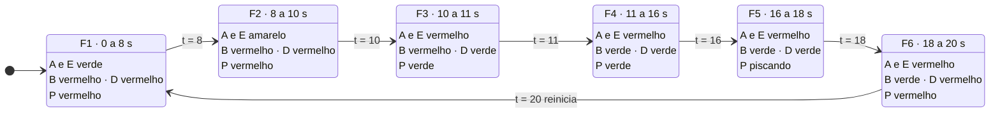
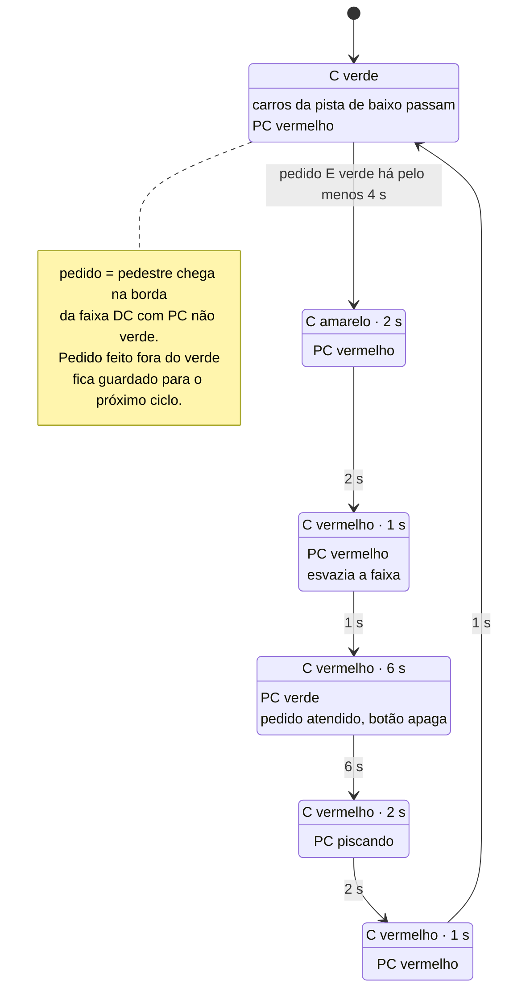
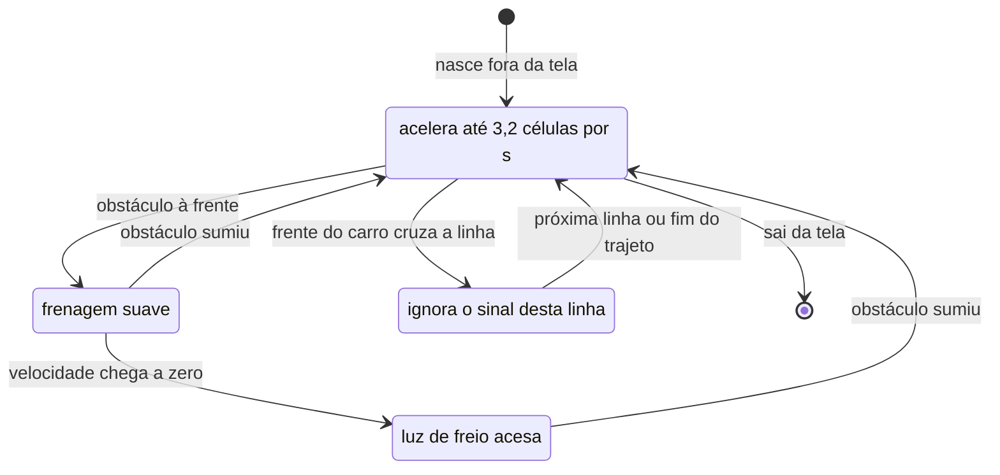
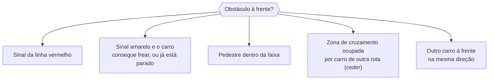
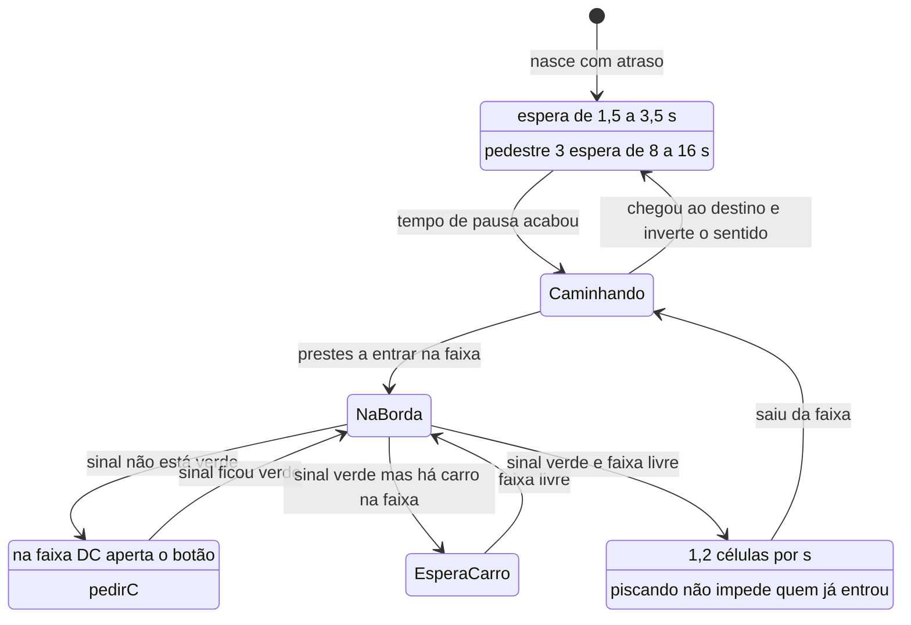
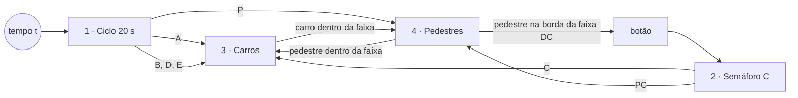

# Diagramas de estados — simulação de semáforos

Complemento de [`FUNCIONAMENTO.md`](FUNCIONAMENTO.md). Cada diagrama espelha o código de [`semaforos.html`](semaforos.html).
Os blocos `mermaid` renderizam no GitHub e no preview do VS Code (extensão *Markdown Preview Mermaid Support*).

O sistema são **4 máquinas de estado** rodando em paralelo:

| # | Máquina | Gatilho | Controla |
|---|---|---|---|
| 1 | Ciclo fixo de 20 s | tempo | A, B, D, E e pedestres das faixas ED e AB |
| 2 | Semáforo C | botão do pedestre | C e pedestre da faixa DC |
| 3 | Carro | sinais, faixas, outros carros | cada veículo |
| 4 | Pedestre | sinal de pedestre, carros na faixa | cada pedestre |

---

## 1. Ciclo fixo de 20 s (A, B, D, E, P)

`t` = tempo dentro do ciclo. O ciclo reinicia sozinho (`t mod 20`).

Invariantes (testados em 1 h simulada):
- **B nunca verde junto com A** (B é o oposto de A, com 1 s de folga em F3).
- **D abre quando E fecha** (F3) e **não depende de C**.
- Pedestre só entra na faixa em **P verde**; em **P piscando** só termina quem já está dentro.

---

## 2. Semáforo C — assíncrono, sob pedido

Fora do ciclo de 20 s. Em repouso fica verde; só fecha se um pedestre apertar o botão.

---

## 3. Carro

Vale para `carro_1` a `carro_4`. Cada carro tem uma ou mais **linhas de parada** (`parar`). Antes de cada linha ele checa os sinais e o que está à frente.

**Obstáculo à frente** é qualquer um destes:

| Rota | Linhas de parada | Cede para |
|---|---|---|
| `carro_1` (topo, oeste) | **E** + faixa ED | — |
| `carro_2` (baixo, leste) | **B** · **C** + faixa DC | — |
| `carro_3` (retorno) | **B** · **D** | `carro_1` em x de 9 a 17,9 |
| `carro_4` (acesso) | **A** + faixa AB | `carro_2` e `carro_3` em x de 0,9 a 4,5 |

---

## 4. Pedestre

Vai e volta entre dois pontos. Cada pedestre tem uma faixa e uma pausa configurável (`pausa`).

---

## 5. Como as máquinas se conversam

Leitura: sinais fluem das máquinas 1 e 2 para carros e pedestres. Carros e pedestres se **travam mutuamente** (carro espera pedestre na faixa; pedestre espera carro sair da faixa). Só o pedestre da faixa DC realimenta o controlador, através do botão.
